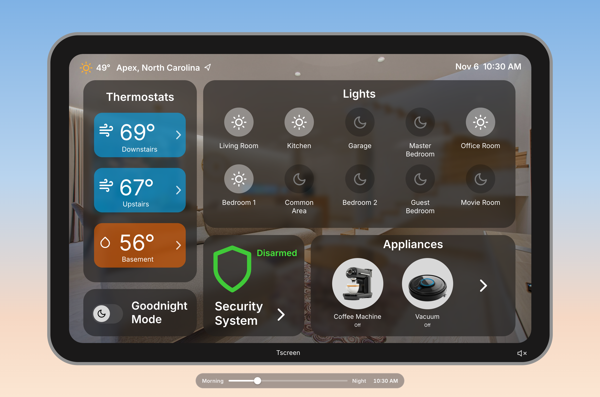

# TScreen

An interactive smart home control panel, built from the original Sketch design. React + TypeScript + Vite.



## Run it locally

```bash
npm install
npm run dev
```

Open http://localhost:5173.

## What works

- **Home:** swipe up (touch or mouse drag) to unlock, or click the bar at the bottom, or press Enter. The bar bounces gently every few seconds as a hint. The clock and date follow the time slider.
- **Lights:** all 10 rooms toggle on and off.
- **Thermostats:** each tile opens its room. Up and down change the temperature by 1° (50–90°), and Cool, Warm, Auto and Off are selectable. The Control Panel tiles always show the current temperature and mode.
- **Security:** Stay and Away arm right away. Disarming asks for a 4-digit code on a keypad (demo code **1234**, also typeable on a keyboard); a wrong code shakes and shows "Wrong code". The Control Panel card shows the current mode in its color. Cameras and Smart Locks open their screens. Emergency shows a demo confirmation and never calls anyone.
- **Appliances and locks:** every switch works. Coffee shows "Brewing…" for 4 seconds, then "Ready"; the vacuum shows "Cleaning…" while on. The Control Panel card shows the same status.
- **Sound (off by default):** the speaker button on the bezel turns it on for as long as the page is open. Security changes speak ("Armed, stay.", "Armed, away.", "Disarmed."), the coffee machine brews and the vacuum starts up. Credits are in [SOUNDS.md](SOUNDS.md).
- **Goodnight Mode:** turns every light off, sets security to Stay, and switches to the night look. Turning it off restores the normal look and leaves lights and security as they are.
- **Sky:** the "Morning — Night" slider starts at the visitor's local time and drives the sky, the clock and the night look. At night, lights that are on give the device a warm glow.
- **Home button:** the "Tscreen" label on the bezel returns to the Home screen.
- **Keyboard and screen readers:** everything works with Tab, Enter, Space and Escape, with visible focus rings and labels for screen readers.

## Sky images

Put four images in `public/sky/`, named exactly `morning.jpg`, `afternoon.jpg`, `sunset.jpg` and `night.jpg`. They replace the gradient placeholders automatically, with no code changes. Around 2560×1600 and under 600 KB each works well.

## Deep links

You can open the app on a specific screen and time. This is useful for embedding one view in a case study.

| URL | Opens |
|---|---|
| `?screen=panel` | Control Panel |
| `?screen=security&time=10:30` | Security at 10:30 AM |
| `?screen=panel&time=22:30&goodnight=1` | Goodnight Mode at night |

Valid screens: `home`, `panel`, `thermo-downstairs`, `thermo-upstairs`, `thermo-basement`, `security`, `appliances`, `cameras`, `locks`.

## Put it online with Vercel (free)

You only do steps 1–3 once. After that, every `git push` goes live automatically.

**1. Put the code on GitHub**

1. Sign in at [github.com](https://github.com) and click **New repository** (the **+** at the top right).
2. Name it `tscreen`, leave it **Public** (or Private, Vercel's free plan works with both), and do **not** add a README, .gitignore or license. Click **Create repository**.
3. In Terminal, push this project. Replace `YOUR-USERNAME`:

```bash
cd "/Users/tarunbaskar/Desktop/Portfolio/Portfolio Projects/TScreen/tscreen-app"
git remote add origin https://github.com/YOUR-USERNAME/tscreen.git
git push -u origin main
```

If Git asks for a password, use a GitHub personal access token, or sign in once with the GitHub Desktop app or `gh auth login`.

**2. Connect Vercel to GitHub**

1. Go to [vercel.com/signup](https://vercel.com/signup), choose **Hobby** (the free plan), and **Continue with GitHub**.
2. Allow Vercel to access your GitHub account. When asked which repositories, you can pick **Only select repositories** → `tscreen`.

**3. Import and deploy**

1. In the Vercel dashboard click **Add New… → Project**.
2. Find `tscreen` in the list and click **Import**.
3. Vercel reads `vercel.json` and fills in **Framework: Vite**, **Build Command: `npm run build`**, **Output Directory: `dist`**. Leave **Root Directory** as it is (the repo root).
4. Click **Deploy**. After about a minute you get a link like `https://tscreen-xxxx.vercel.app`.
5. Optional: in **Project → Settings → Domains**, rename it to something like `tscreen.vercel.app`, or add your own domain.

**4. Future changes go live automatically**

- Every push to `main` triggers a new production deploy.
- Pushes to other branches (or pull requests) get their own preview link, so you can check a change before merging it.
- If a build fails, the previous version stays online and Vercel emails you.

**5. Embed it in Framer**

1. In Framer, insert an **Embed** component and choose **URL**.
2. Paste your Vercel link, or a deep link such as `https://tscreen.vercel.app/?screen=panel`.
3. Size the embed to roughly 1512×982 (or any similar shape). The app scales itself to fit.
4. Sound needs a click first (browsers block autoplay), which the speaker button provides.

GitHub Pages also works: see `.github/workflows/deploy-pages.yml` for a manual-run alternative.

## Design fixes

See [FIXES.md](FIXES.md). Sound credits are in [SOUNDS.md](SOUNDS.md).

## Project layout

```
src/
  App.tsx              scaling, sky, time slider, night filters
  state/store.tsx      all app state (reducer) and deep links
  lib/time.ts          scene clock, dates, sky stages
  lib/design.ts        shared design values (mode colors, zones)
  components/          device frame, transitions, icons, shared UI
  screens/             Home, Control Panel and the detail screens
  assets/              images exported from the Sketch file
public/sky/            drop the four sky images here
```
